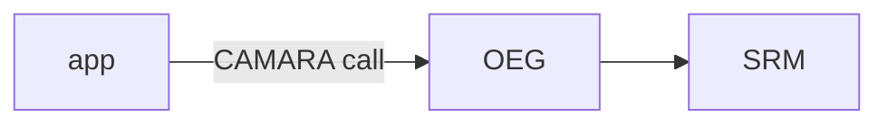

# Writing a Hype presentation

A presentation is one Markdown file. Edit it with any text tool, then use
`hype check`, `hype render`, and `hype export` to verify and ship it. If the
file is open in the Hype editor, saved edits appear there as long as the editor
has no unsaved changes of its own.

## Layout on disk

```text
my-talk/
  presentation.md
  images/      photos, diagrams, animated GIF/WebP, SVG
  videos/      mp4, m4v, mov, webm, mkv
```

Media is referenced by filename only: `` reads `images/city.jpg`
and `` reads `videos/demo.mp4`.

## Front matter

```markdown
---
title: "My talk"
theme: tokyo-night
font: "JetBrains Mono"
---
```

`hype new` writes this for you, along with the theme's `color_*` values.
`hype themes` lists the installed themes. Any `color_*` value can be
overridden with a `#rrggbb` color: `color_background`, `color_foreground`,
`color_accent`, `color_green`, `color_red`, `color_yellow`, `color_magenta`,
`color_cyan`, `color_dark_foreground`.

For documents more than talks, such as a proposal or a brand book, fix the
typography instead of letting each slide grow its text to fill the space:

```markdown
---
font: "Instrument Sans"
heading_font: "Newsreader"
heading_weight: 400
text_size: 24
heading_size: 64
header: "Company · Proposal"
---
```

`heading_font` sets headings in a second font, and `heading_weight` their
weight from 100 to 900 (default 700). `text_size` is the body text's size in
pixels on a 1080p slide, from 8 to 200; with it, every slide uses that size,
headings use `heading_size` (default two and a half times the text), and text
starts at the top of its area, so headings line up from slide to slide. Text
still shrinks when a slide holds too much, and `hype check` warns when it does.
`header` adds a small running header: this text on the left, and the slide's
section and number on the right.

A slide names its section, and can move its text up or down, in a `hype`
comment:

```markdown
<!-- hype: section="Context" vertical="center" -->
```

`vertical` is `top`, `center`, or `bottom`; text is centered unless the deck
has a `text_size`, where it starts at the top.

`hidden="true"` keeps a slide in the deck but out of the talk: presenting
skips it, exports leave it out, and the running header does not count it.
`hype export` and `hype render` take `--include-hidden` to keep such slides.

## Build steps

A slide can build up while presenting, written as pandoc writes beamer
slides. A line holding only `. . .` pauses; what follows it appears on the
next step:

```markdown
# Why now

The radio is the bottleneck

. . .

Only the operator can fix it
```

`incremental: true` in the front matter reveals every list one item at a
time; the first item shows with what comes before it. Fence a list in
`::: incremental` or `::: nonincremental` to set it for that list alone. A
picture after a pause appears on its own step. Steps are laid out as the
finished slide, so text never moves as it appears. Exports show finished
slides; `hype export talk.pdf --steps` gives each step a page, and
`hype render --slide 3 --step 2` renders one step.

## Math

Write TeX math as pandoc reads it: `$E = mc^2$` in a line, and `$$…$$` for a
displayed formula, centered when it stands on its own lines. LaTeX sets it as
beamer does, in sans-serif; `math_font: serif` in the front matter takes
beamer's serif math instead. `amsmath`, `amssymb`, `mathtools` and `bm` are
loaded. A `$` needs a non-space after the opening one and before the closing
one, so prices such as $5 stay text; write `\$` for a literal dollar.

```markdown
# Why the radio dominates

$$\ell = \ell_{\text{radio}} + \ell_{\text{core}}$$

with $\ell_{\text{radio}} \approx 5$–$20\,\text{ms}$
```

Math needs `latex` and `dvisvgm` from TeX Live. Each formula is typeset once
and kept in `~/.cache/hype/math`. A formula LaTeX rejects shows as red TeX on
its slide, and `hype check` reports LaTeX's message with the formula.

## Slides

Separate slides with a line holding only `---`, with a blank line on either
side. Slides are 16:9 and text is sized to fit, so say less per slide: a
headline, a few bullets, or one short quote. `hype check` warns when a slide
holds so much that its text shrinks below a readable size.

````markdown
# A big idea

---

# Keep it simple

- Write in Markdown
- Tell your story

---

> Make something wonderful.

---

```ruby
puts "Code is highlighted when you name the language"
```
````

- `# Headline` is big. Lists, quotes, tables, and inline `code` work.
- `*asterisks*` are italic, `**double**` is bold, `_underscores_` underline.
- Ordinary line breaks stay visible on the slide.
- Tables use `| pipes |`; `:---:` centers a column and `---:` aligns it right.
  More than one space beside a cell's text pads it.
- `<!-- comments -->` are hidden from the slide; use them for speaker notes.
- A `---` inside a code fence does not split the slide.

## Images and video

Each slide takes one image or video. Options go inside the brackets:

| Markdown | Result |
| --- | --- |
| `` | Show the whole image |
| `` | Fill the slide, cropping as needed |
| `` | Show the whole image, with any text overlaid |
| `` | Fill the space around it with a color |
| `` | Fill it with a blurred copy of the image |
| `` | Match the image's edge color |
| `` | Darken the picture behind text, from 0 to 1 |
| `` | Loop a video without sound |
| `` | Wait for Space to play the video |
| `` | Show an image from `images/` until it plays |
| `` | Place a small image, such as a logo, in a corner |
| `` | Image on the left half, text beside it on the right |
| `` | Image on the right 40%, text in the rest |
| `` | Headline on top, image filling the lower 70% |
| `` | Image on a colored left half |

An `svg` code block draws SVG in the image's place, sharp at any size. Give it
a `viewBox`. `var(--accent)`, `var(--foreground)`, `var(--background)`,
`var(--dark-foreground)`, `var(--red)`, `var(--green)`, `var(--yellow)`,
`var(--magenta)`, and `var(--cyan)` are the theme's colors. Shapes and text
without a color take the theme's text color, and text takes the font.

````markdown
```svg
<svg viewBox="0 0 300 120">
  <rect x="120" y="20" width="60" height="100" fill="var(--accent)"/>
</svg>
```
````

A `mermaid` code block draws a Mermaid diagram in the same place, laid out as
GitHub lays it out and in the deck's colors and font. `mermaid_theme:
default`, `neutral`, `dark`, or `forest` in the front matter uses one of
Mermaid's own themes instead. It needs the Mermaid CLI (`mmdc`) and
`pdftocairo`; each diagram is drawn once and kept in `~/.cache/hype/mermaid`,
and `hype check` reports Mermaid's message for a diagram it cannot draw.

````markdown

````

An SVG file in `images/` can have its labels retyped on the slide: double-click
one in the editor, type, and press Enter. To keep a drawing editable this way,
write each label as its own `<text>` at one `x` and `y`, holding only its words:
no `<tspan>`, and no `transform` on it or around it. Labels written otherwise
still draw; they just cannot be retyped in place.

```xml
<text x="250" y="93" font-size="34" text-anchor="middle">developer's app</text>
```

Text on an image slide is overlaid in white over a slightly darkened picture.
An image with a headline spans the slide unless you say `fit`.

A placed image leaves the slide's text and theme colors alone. `position` is
`top-left`, `top`, `top-right`, `left`, `center`, `right`, `bottom-left`,
`bottom`, or `bottom-right`; `size` is the share of the slide it may fill, from
1% to 100% (default 10%). Placement is for images only and cannot be combined
with `fit`, `span`, `background`, or `overlay`.

A split image shares the slide with the text instead of sitting under it: the
text keeps the theme's colors, is never darkened, and reads from the left in a
side column. `split` is `left`, `right`, or `bottom`; `size` is the image's
share of the slide (default 50%, or 60% for `bottom`). `background` colors the
image's side of the slide, edge to edge. Split works with still and animated
images, not videos, and cannot be combined with `fit`, `span`, `position`, or
`overlay`.

## Commands

```text
hype new talk/presentation.md --title "My talk" --theme tokyo-night
hype check talk/presentation.md --json     every problem, with slide and line
hype slides talk/presentation.md --json    an outline of the slides
hype render talk/presentation.md --slide 3 -o slide.png
hype render talk/presentation.md -o slides/        every slide, plus slides.json
hype export talk/presentation.md talk.pdf          or talk.pptx
```

Commands need no display. They exit 0 on success and 1 on failure, with errors
on stderr. Render a slide and look at the PNG to judge how it reads.
